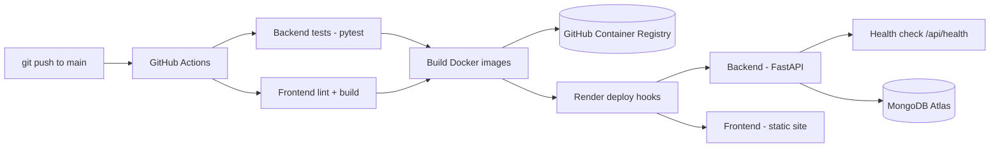

# ParentApp

[](https://github.com/Dinesh16680-M/Parent-app/actions/workflows/ci-cd.yml)

A parenting support web app built as part of a project at OTH Amberg-Weiden. It provides AI-powered chat, mood tracking, developmental milestone tracking, calm tools, and curated learning resources — all personalised to the parent's profile and their children's ages.

---

## Features

- **AI Chat** — Conversational parenting support powered by AI via OpenRouter, with full chat history saved to MongoDB
- **Mood Check-in** — Daily mood logging with personalised AI advice; entries saved to your account
- **Milestone Tracker** — Developmental milestone checklist personalised to each child's age range, synced to MongoDB
- **Calm Tools** — Box breathing, reset timers, and AI-generated grounding prompts
- **Parenting Tips** — Age-filtered tips generated by AI on demand
- **Learning Hub** — Curated articles and in-app Q&A per topic
- **Emergency Page** — Grounding steps, breathing animation, and crisis resources
- **Profile** — Stores name, role, children (nickname + age range), challenges, and preferred response style

---

## Tech Stack

| Layer | Technology |
|---|---|
| Frontend | React 19, Vite, React Router v7 |
| Styling | Custom CSS |
| Backend | Python, FastAPI, Uvicorn |
| Database | MongoDB Atlas (via Motor async driver) |
| AI | OpenRouter API (free models, e.g. NVIDIA Nemotron) |
| Auth | JWT (python-jose) + bcrypt |

---

## Project Structure

```
parentApp/
├── parentapp-frontend/          ← React + Vite
│   ├── Dockerfile               ← Node build → nginx
│   ├── nginx.conf
│   ├── public/
│   ├── index.html
│   └── src/
│       ├── components/
│       │   ├── calm/            ← BreathingAnimation, CalmTimer
│       │   ├── chat/            ← ChatSidebar
│       │   ├── layout/          ← Header, Footer
│       │   └── onboarding/      ← OnboardingModal
│       ├── context/             ← AuthContext (global auth + profile state)
│       ├── data/                ← Static data (milestones, tips, quick actions)
│       ├── layouts/             ← RootLayout with auth guard
│       ├── pages/               ← One folder per route
│       ├── routes/              ← React Router config
│       └── utils/               ← API helpers (apiBase.js) and localStorage utilities
│
├── parentapp-backend/           ← FastAPI
│   ├── main.py                  ← App entry point
│   ├── Dockerfile
│   ├── requirements.txt
│   ├── requirements-dev.txt     ← pytest + in-memory MongoDB for tests
│   ├── tests/                   ← API tests
│   ├── .env                     ← Not committed — see Environment Variables
│   └── app/
│       ├── config.py            ← Env vars and constants
│       ├── database.py          ← MongoDB client
│       ├── dependencies.py      ← JWT auth / get_current_user
│       ├── prompts.py           ← AI system prompt and profile context builder
│       ├── schemas.py           ← Pydantic models
│       ├── services/
│       │   └── ai.py            ← OpenRouter HTTP helpers (stream + get)
│       └── routers/
│           ├── auth.py          ← /api/auth/*
│           ├── chat.py          ← /api/chat, /api/chats
│           ├── mood.py          ← /api/mood-*
│           ├── milestones.py    ← /api/milestones
│           ├── tips.py          ← /api/tips, /api/tip-of-day
│           ├── calm.py          ← /api/calm-prompt
│           └── learning.py      ← /api/topic-*
│
├── .github/workflows/ci-cd.yml  ← CI/CD pipeline (tests, Docker images, deploy)
├── docker-compose.yml           ← Full local stack (MongoDB + backend + frontend)
├── render.yaml                  ← Render deployment blueprint
└── .gitignore
```

---

## Getting Started

### Prerequisites

- Node.js 18+
- Python 3.10+
- A MongoDB Atlas cluster (free tier works)
- An OpenRouter API key (free tier available at openrouter.ai)

---

### Backend

```bash
cd parentapp-backend

# Create and activate virtual environment
python -m venv venv
source venv/bin/activate        # Windows: venv\Scripts\activate

# Install dependencies
pip install -r requirements.txt

# Create .env file (see Environment Variables below)
cp .env.example .env

# Start the server
uvicorn main:app --port 4000 --reload
```

The backend runs at `http://localhost:4000`.

---

### Frontend

```bash
cd parentapp-frontend

# Install dependencies
npm install

# Start the dev server
npm run dev
```

The frontend runs at `http://localhost:5173`.

---

## Environment Variables

Create a `.env` file in `parentapp-backend/` with the following:

```env
MONGODB_URI=mongodb+srv://<user>:<password>@<cluster>.mongodb.net/
OPENROUTER_API_KEY=sk-or-...
JWT_SECRET=your-long-random-secret-here
OPENROUTER_MODEL=nvidia/nemotron-3.5-super-vl:free
```

| Variable | Description |
|---|---|
| `MONGODB_URI` | MongoDB Atlas connection string |
| `OPENROUTER_API_KEY` | API key from openrouter.ai |
| `JWT_SECRET` | Secret used to sign JWT tokens — use a long random string in production |
| `OPENROUTER_MODEL` | Optional. Which OpenRouter model to use (default: nvidia/nemotron-3.5-super-vl:free) |

---

## API Endpoints

| Method | Path | Description |
|---|---|---|
| POST | `/api/auth/register` | Register a new user |
| POST | `/api/auth/login` | Login and receive JWT |
| GET | `/api/auth/me` | Get current user profile |
| PUT | `/api/auth/profile` | Update user profile |
| POST | `/api/chat` | Streaming AI chat |
| POST | `/api/chat-title` | Generate a title for a chat |
| GET | `/api/chats` | Get all saved chats |
| POST | `/api/chats` | Save or update a chat |
| DELETE | `/api/chats/{id}` | Delete a chat |
| POST | `/api/mood-advice` | Streaming mood-based AI advice |
| GET | `/api/mood-log` | Get mood history (last 30) |
| POST | `/api/mood-log` | Save a mood check-in |
| GET | `/api/milestones` | Get milestone checked state |
| PUT | `/api/milestones` | Save milestone checked state |
| POST | `/api/calm-prompt` | Generate an AI grounding prompt |
| POST | `/api/tips` | Generate age-filtered parenting tips |
| POST | `/api/tip-of-day` | Generate today's tip |
| POST | `/api/topic-content` | Generate full content for a learning topic |
| POST | `/api/topic-qa` | Streaming Q&A on a learning topic |
| GET | `/api/health` | Health check |

---

## DevOps



| Area | What is used |
|---|---|
| Containers | `Dockerfile` for backend (Python, non-root user, healthcheck) and frontend (multi-stage Node build served by nginx) |
| Local environment | `docker compose up --build` starts MongoDB, backend and frontend together |
| CI | GitHub Actions runs pytest (in-memory MongoDB) and lints/builds the frontend on every push and pull request |
| Registry | Images are pushed to GitHub Container Registry (`ghcr.io`) tagged `latest` and with the commit SHA |
| CD | Render deploys only after all checks pass (deploy hooks, `autoDeploy: false`), followed by an automatic health check |
| Infrastructure as code | `render.yaml` Blueprint describes both services and their environment |
| Secrets | Kept out of Git: `.env` locally, Render environment variables and GitHub Actions secrets in the cloud |

### Run everything with Docker

```bash
docker compose up --build
```

Website: http://localhost:8080 · API: http://localhost:4000/api/health

### Run the backend tests

```bash
cd parentapp-backend
pip install -r requirements-dev.txt
pytest -v
```

---

## Deployment

Hosting is on [Render](https://render.com) (free plan), described in `render.yaml`. Deploys are triggered by the CI/CD pipeline, so code only goes live after the tests pass.

1. On Render: **New + → Blueprint**, select this repository, and fill in `MONGODB_URI` and `OPENROUTER_API_KEY`. `JWT_SECRET` is generated automatically.
2. For each service, copy its **Deploy Hook** URL (Settings → Deploy Hook).
3. In GitHub: **Settings → Secrets and variables → Actions**, add the secrets `RENDER_DEPLOY_HOOK_BACKEND` and `RENDER_DEPLOY_HOOK_FRONTEND`.
4. Every push to `main` now runs tests → builds images → deploys → checks `/api/health`.

If the backend URL is not `https://parentapp-backend.onrender.com`, set `VITE_API_URL` on the frontend service and the `BACKEND_URL` Actions variable to the real URL.

---

## Team

| Name | Role |
|---|---|
| Vishal Naroju | UI implementation & component integration |
| Dinesh Mariappan | UI design, styling & backend services |
| Animesh Mondol | Chat interface & frontend-backend integration |
| Mitali Gaikwad | API development & backend services |
| Nidhi Bennur | AI integration & prompt engineering |
